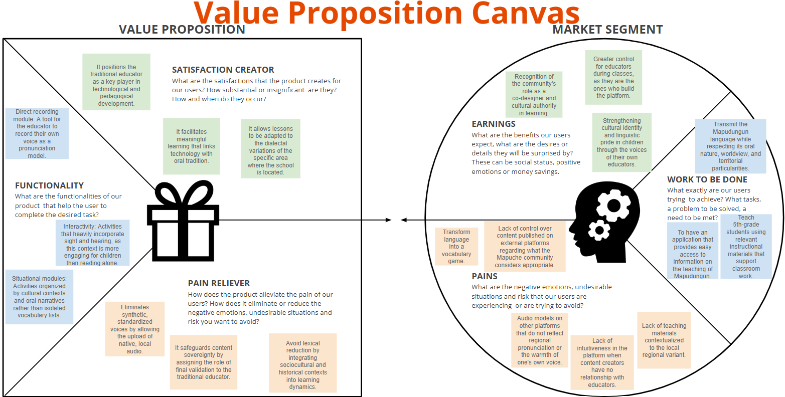
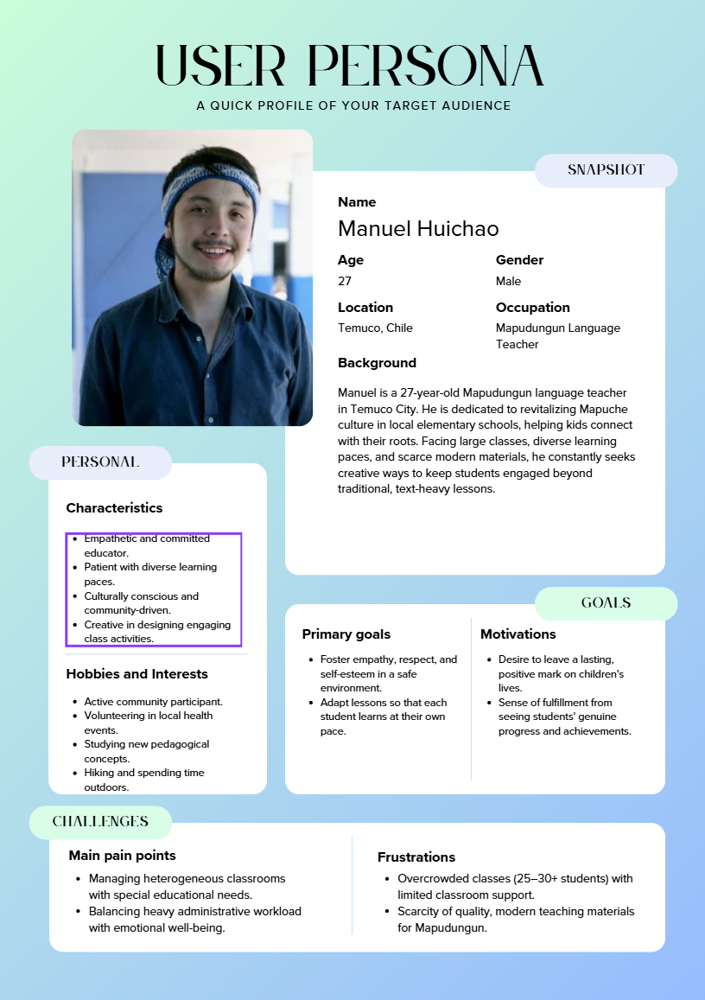
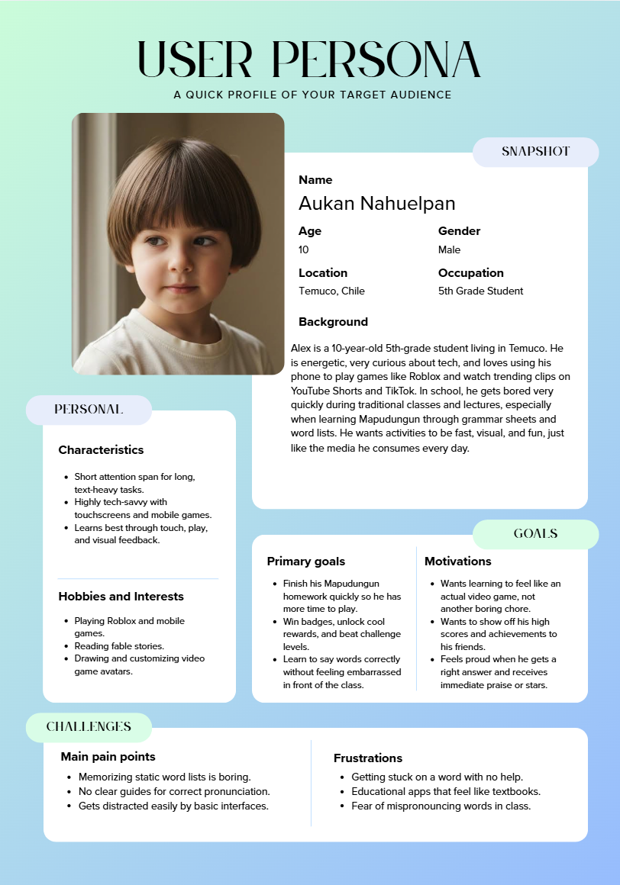
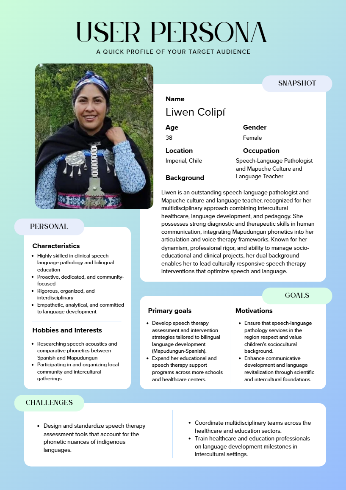
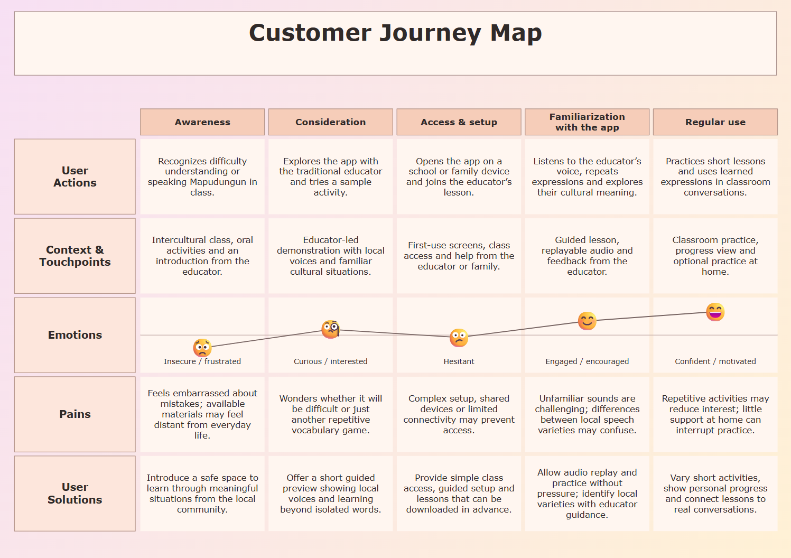
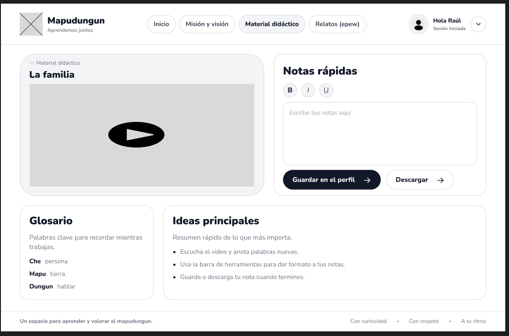
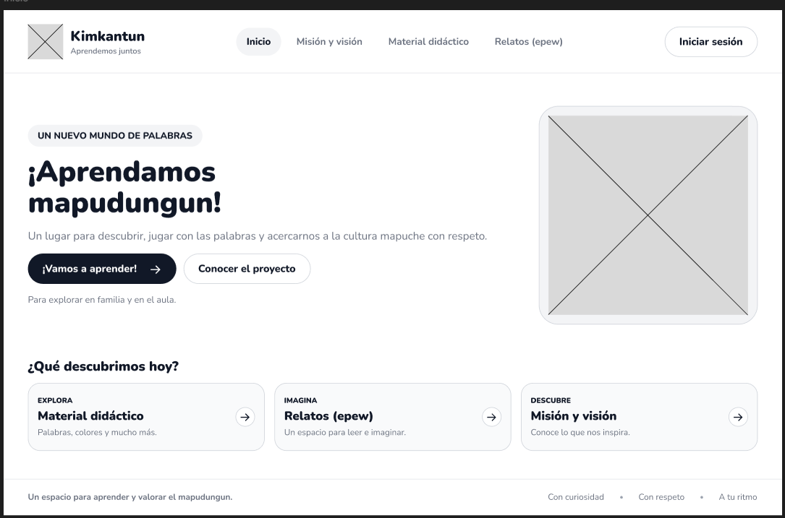
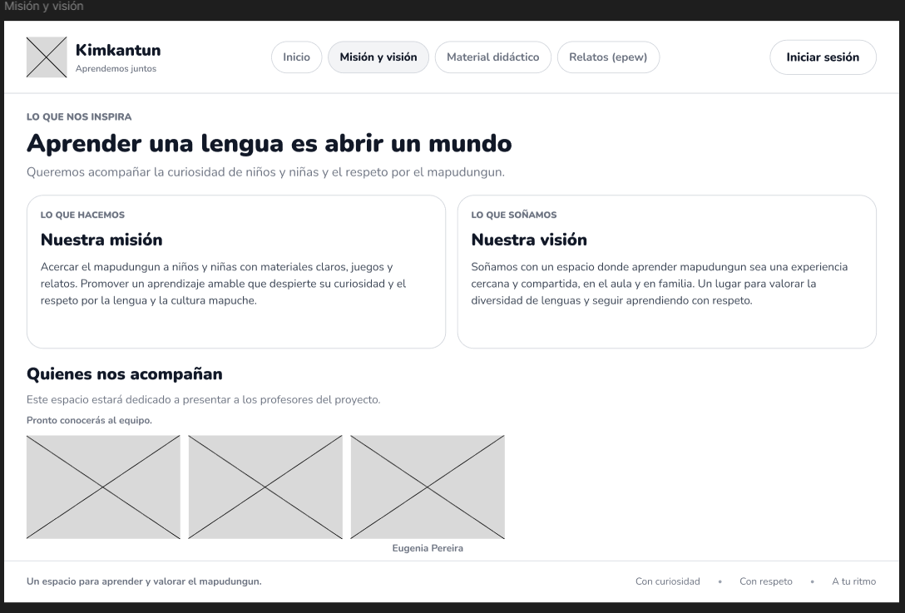

# Mapudungun Learning UX Project (WIP)

User experience study for an intercultural Mapudungun learning application

## Index

- [1. Introduction](#1-introduction)
- [2. Team](#2-Team)
- [3. Strategy](#3-strategy)
- [4. Solutions Scope](#4-solutions-scope)
- [5. Benchmark](#5-Benchmark)
- [6. Customer Journey Map](#6-customer-journey-map)
<!--
- [7. Navigation](#7-Navigation)
  - [7.1. Initial Aporach](#71-first-aproach)
  - [7.2. Improved Navigation](#72-improved-navigation)
-->
- [7. Wireframes](#8-wireframes)
<!--
- [9. Mockups](#9-mockups)
  - [9.1. Initial Aproach](#91-initial-aproach)
  - [9.2. Improved Mockups](#92-improved-mockups)
-->

---

## 1. Introduction
The teaching of Mapudungun in primary schools in the La Araucanía region relies
heavily on traditional educators, who often face challenges such as scarce materials,
dialectal variations, and a strong focus on oral tradition. Translating this experience
into a mobile application involves critical, non-trivial decisions: who validates the
content, how to accurately represent pronunciation, and how to avoid reducing the language
to a simple vocabulary game. This process requires treating the community as co-designers
rather than just data sources.

With this project, we will be focusing on developing an application based on the Elements
of User Experience to ensure the language is taught authentically. The goal is to empower
traditional educators to use their own voices as pronunciation models and decide the
published content, bridging the gap between traditional oral teaching and modern digital
platforms.

---

## 2. Team

Diego Aido - Designer

Vicente Hernández - Researcher

Rocio Pérez - Project Manager

---

## 3. Strategy

The first step under the Elements of User Experience is the Strategy plane,
which focuses on incorporating not only what the people running the application
want to get out of it but what the users want to get out of the application.

From this approach, a Value Proposition Canvas is used to determine what the
people want to earn from our solution and how we are going to respond to those needs.

---

## 4. Solutions Scope

The application is designed to support the intercultural teaching of Mapudungun,
specifically tailored to engage 5th-grade students (around 9 to 10 years old).
It addresses the challenge of keeping young students engaged—who can easily get
bored with traditional methods and are used to fast-paced digital entertainment—by
providing interactive, culturally relevant content. 

The app allows traditional educators to record their own voices and curate lessons
to respect local dialects, ensuring the language is taught exactly as it is spoken
in their communities. In short, it is a dynamic, community-driven educational tool
that prevents the language from being reduced to a mere game while maintaining an
experience engaging enough for young digital natives.

---

## 5. Benchmark

---

## 6. Customer Journey Map
We created a Customer Journey Map to explore how a 5th-grade student might experience our Mapudungun learning application, from discovering it in class to using it regularly. We divided this journey into five stages: awareness, consideration, access and setup, familiarization with the app, and regular use. For each stage, we considered the student's actions, touchpoints, emotions, possible difficulties, and proposed solutions.

The map helped us consider more than the activities offered by the app. Students may feel embarrassed when practicing unfamiliar sounds, struggle with the initial setup, or lose interest if the lessons become repetitive. Our proposed responses include guided access, replayable recordings from traditional educators, and short activities connected to everyday situations and local culture. Throughout the journey, the traditional educator remains an important source of guidance and encouragement.

This map represents our proposed experience rather than findings from user testing. We will need to validate these assumptions with students and traditional educators to understand whether the application supports their learning needs and respects the way Mapudungun is spoken in their communities.

---
<!--
## 7. Navigation

### 7.1. First Aproach

### 7.2. Improved Navigation

---

-->

## 7. Wireframes

.png)

---

<!--
## 9. Mockups

### 9.1. Initial Aproach

### 9.2. Improved Mockups

---
-->